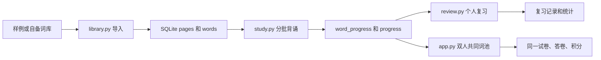

# 词间 · IELTS 词汇共学 v2.0


词间是一个运行在本机的双人词汇学习工具。两位学员各自背词、复习和查看进度，也可以用两人共同学过的词发起同卷对战。公开版包含四组共 24 个样例词，默认使用匿名的「学员 A」和「学员 B」。

## v2.0 更新

- **Mac 主窗口。** 学习页面现在直接显示在应用内，从 Dock 或菜单栏即可打开。
- **可学习的置顶浮窗。** 在系统菜单栏选择「词间 → 在浮窗打开每日复习」，可以拖动、调整窗口大小，并在其他应用前继续作答。
- **大小窗共享当前页面。** 按 `⌘2` 切换时保留当前题目和已填内容，按 `⌘1` 回到主窗口。首次直接打开复习浮窗时，登录后会进入「每日复习」。
- **新 App 图标。** macOS 应用使用 IELTS 8.0 奖杯插画，构建脚本生成适配 Finder 和 Dock 的多尺寸图标。

## 当前支持

| 功能 | 使用方式 |
| --- | --- |
| 分批背词 | 按主题选词，先看词义、音标和已有例句，再做中译英、英译中、拼写 |
| 每日复习 | 从已学词中按复习时间取题，错题在本轮重练，支持退出续做 |
| 学习统计 | 今日和累计复习词数、日均、待复习词及近 7 天记录 |
| 双人对战 | 从两位学员的共同词池出同一套题，自动判分、计积分和发送站内消息 |
| 键盘操作 | 选择题支持数字 1–4、上下键和 Enter，默认聚焦第一项 |
| 本地运行 | 可用浏览器或 Mac App；两个入口共用项目目录的 SQLite 数据 |

## 快速开始

### macOS App

桌面版需要 macOS 13 或以上，以及一个安装了 Flask 依赖的 Python 3.10+ 环境。

- Apple 芯片 Mac 可下载 [v2.0 发布页](https://github.com/lxj43/ielts-study-platform/releases/tag/v2.0) 的预编译包，并解压整个目录。
- 也可以下载源码，用本机 macOS 命令行开发工具编译。下列命令在解压后的项目目录，也就是包含 `app.py` 的目录运行。

```sh
python3 -m venv .venv
. .venv/bin/activate
python -m pip install -r requirements.txt
# 使用源码时编译应用
./scripts/build_desktop.sh
```

双击目录里的「词间悬浮学习.app」，选「学员 A」或「学员 B」。应用自动启动同目录的本地服务，桌面版默认使用 `127.0.0.1:52732`。菜单栏提供主窗口、浮窗和每日复习入口。预编译包使用临时本地签名，遇到 macOS 开发者验证提示时，可以在本机从源码编译。

### 浏览器

需要 Python 3.10 或以上。在仓库目录运行：

```sh
python3 -m venv .venv
. .venv/bin/activate
python -m pip install -r requirements.txt
python app.py
```

打开 [词间本地页面](http://127.0.0.1:5000)，选择一个学员。在「单词背诵」选一个主题页，完成一批后就可以进入「每日复习」。账户通过页面直接选择，适合在可信设备上使用。

## 一次学习如何走完整个流程



### 1. 背诵按批进行，词和页分别记进度

选中词库页并填写词数后，[app.py](app.py) 的 `learn_page()` 调用 [study.py](study.py) 的 `begin_session()`。新批次优先取本页尚未完成的词；返回已有会话时会继续原来的进度。

一批依次经过**整体记忆 → 中译英 → 英译中 → 英文拼写**。整体记忆页可以查看词义、音标和现有例句。答错的题会回到本轮队尾，答对后可继续下一题。背诵环节提供跳过拼写的入口。一批结束后，服务端把该批词写入 `word_progress`；本页所有词都有完成记录时才写入 `progress`。

`study_sessions` 保存批次所含单词、当前轮次、题目队列和反馈。每一步提交都带当前状态的 `nonce`，这样刷新或重复提交旧表单时，学习会话不会被重复推进。

### 2. 每日复习从个人已学词中取题

从某个学员的已学词集合出发，`choose_words()` 优先选从未复习过的词，其次选距上次复习最久的词。`make_questions()` 为每个入选词生成中译英、英译中和拼写三道题。题目在创建时写入 `reviews`，答到哪一步保存在 `review_sessions`，所以退出后可以继续原来那组题。

[review.py](review.py) 的 `advance_review()` 负责逐题判分。错题回到本轮待答队列，继续作答时会再次遇到。复习中一个词通过两个互译轮次并答对拼写时，[app.py](app.py) 将它记入 `review_word_days`。一组完成后，结果页同时展示首次答对数和重试情况。

| 统计 | 计算口径 |
| --- | --- |
| 今日已复习 | 今天完成三轮的不同词数，以 UTC+8 日期为界 |
| 累计复习 | 各天复习词数之和，同一个词在不同日期可重复计入 |
| 日均复习 | 累计复习词次除以从首次复习到今天的自然日数 |
| 已复习和待复习 | 在我的已学词池中，分别统计曾复习通过的词和仍未通过的词 |
| 近 7 天 | 按天汇总复习词数，柱高按本区间最大值缩放，0 词显示零线 |

### 3. 对战取双方共同词池，发送相同试卷

`/battles` 查询双方均已学习的词。从共同词池抽题后，试题和参考答案一起保存到 `battles`，双方都使用这份题目快照。每位学员提交一次，对应 `attempts` 中一条记录。两人交卷后在数据库写事务里统一结算，按答对总题数判胜，胜者加 1 分，平局保持原积分。邀请、交卷和结算消息可在「账户消息」查看。

## 文件如何分工

| 文件 | 职责 |
| --- | --- |
| [app.py](app.py) | 创建 Flask 应用、登录与表单校验、注册页面路由、题目生成、对战评分和数据库事务 |
| [library.py](library.py) · [schema.sql](schema.sql) | 校验词库结构、按词库编号导入，并定义词汇、学习、复习、对战和消息表 |
| [study.py](study.py) · [templates/study.html](templates/study.html) | 维护背诵状态，渲染当前记忆卡、题目和学习反馈 |
| [review.py](review.py) · [templates/review.html](templates/review.html) · [templates/review_practice.html](templates/review_practice.html) | 维护复习队列、计算每日统计并渲染选题与作答页面 |
| [templates/quiz.html](templates/quiz.html) · [templates/result.html](templates/result.html) | 渲染整张试卷与交卷结果 |
| [static/study.js](static/study.js) · [static/theme.css](static/theme.css) | 实现选择题的 1–4、上下键和 Enter 操作，以及焦点提示和不同宽度的布局 |
| [desktop/StudyLauncher.swift](desktop/StudyLauncher.swift) | 启动并检查本地服务，用同一个 WebKit 学习视图在主窗口和置顶浮窗之间切换 |
| [scripts/build_desktop.sh](scripts/build_desktop.sh) · [desktop/AppIcon.png](desktop/AppIcon.png) | 生成并签名 macOS App，将插画转换为系统图标 |

## 数据与桌面入口

- [data/sample_words.json](data/sample_words.json) 是公开版默认词库。[data/study_materials.json](data/study_materials.json) 按英文词条补充例句和翻译。
- 自备词库可以沿用样例格式，包括 `key`、`title` 和 `pages`，每页包含序号、标题及带英文和中文的词条。用 `IELTS_VOCABULARY_FILE` 将应用指向该 JSON；为不同词库使用独立的 `key`，便于区分数据。
- 首次启动会在 `instance/` 新建 SQLite 数据库和应用会话密钥。学习与答卷记录保存在该数据库中。
- 从 v1.0 升级时，在原目录更新应用与代码，并保留 `instance/`，即可继续使用原账户进度。App 与其所在目录的 `app.py`、`data/` 和 `instance/` 配套使用。

## 测试

```sh
python -m unittest discover -s tests
```

[tests/](tests/) 覆盖样例词库导入、学习和复习进度、双人对战结算，以及旧数据迁移。
